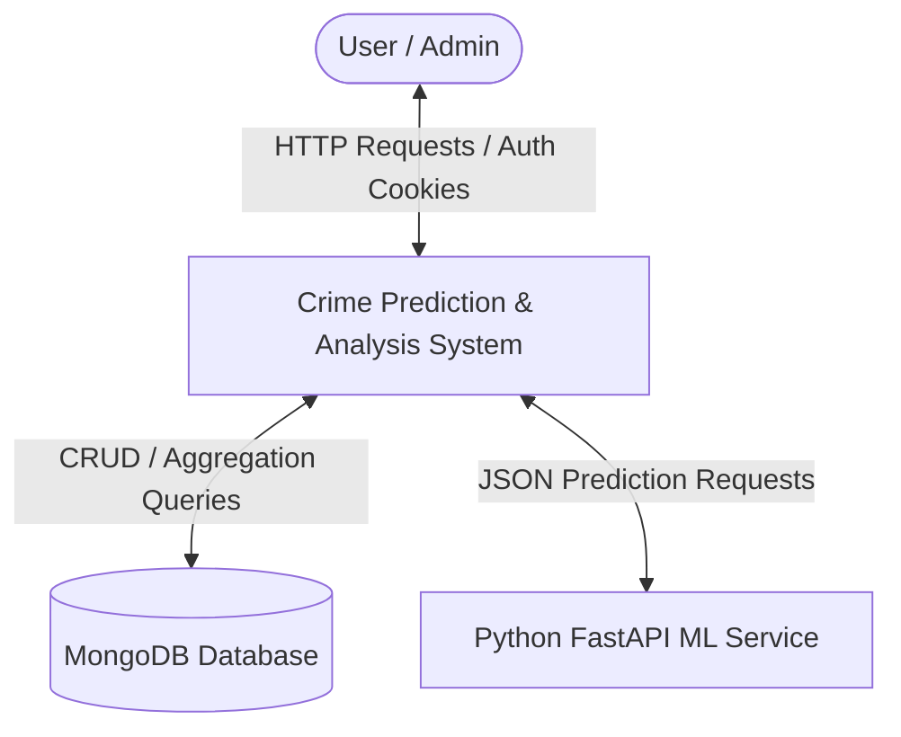
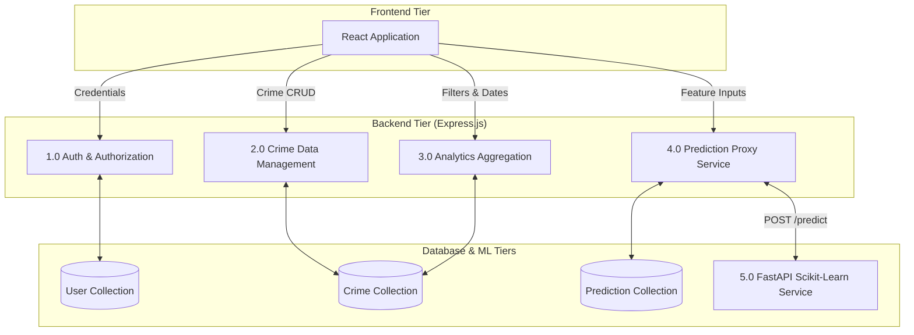

# Academic Project Documentation: Crime Prediction & Analysis System

**Project Title**: Crime Prediction and Analysis System  
**Academic Degree**: Bachelor of Computer Applications (BCA) Minor Project  
**Tech Stack**: React 18, Vite, Tailwind CSS, Node.js, Express, MongoDB, Python, FastAPI, Scikit-Learn  

---

## 1. Abstract
The **Crime Prediction and Analysis System** is a web-based, full-stack decision-support system designed to analyze historical crime records, visualize crime distribution geographically and temporally, and generate statistical estimates of crime categories based on spatio-temporal parameters. The system employs a modern decoupled architecture consisting of a React frontend, Node.js/Express backend API, MongoDB database, and a dedicated Python FastAPI service equipped with Scikit-learn machine learning pipelines.

---

## 2. Introduction & Problem Statement

### 2.1 Problem Statement
Law enforcement administrators and public policy analysts face challenges in identifying spatial and temporal patterns within large volumes of reported crime data. Traditional manual statistical reporting methods lack real-time visual exploration tools, interactive geographical heatmaps, and automated predictive classification capabilities.

### 2.2 Proposed Solution
The proposed system addresses these gaps by providing:
1. **Interactive Data Management (CRUD)**: Authorized administrators can record, update, and categorize crime records with pagination and multi-variable filtering.
2. **Dynamic Graphical Analytics**: Aggregated metrics (daily/monthly trends, severity distribution, time-of-day buckets, location breakdown) rendered via Recharts.
3. **Geographical Visualization**: Interactive map markers using Leaflet and OpenStreetMap.
4. **Machine Learning Predictions**: A trained machine learning classifier (Random Forest / Logistic Regression) that estimates probable crime categories from temporal (Month, Day of Week, Hour) and spatial (City, Severity) parameters.

---

## 3. Ethics & Responsible AI Considerations

> [!IMPORTANT]
> **Ethical & Academic Constraints Enforced**:
> - **No Person-Level Prediction**: The system predicts *historical spatio-temporal crime category probabilities* for a region/time context. It **does not** predict whether any specific individual will commit a crime.
> - **No Sensitive Attributes**: No personal demographic attributes (race, ethnicity, religion, caste, individual names, or facial data) are collected or evaluated by the ML pipeline.
> - **Bias Disclaimer**: Predictions are statistical estimates derived from historical reported data, which may contain reporting biases.

---

## 4. System Requirements

### 4.1 Software Requirements
- **Operating System**: Windows 10/11, Linux, or macOS
- **Runtime Environment**: Node.js (v18+), Python (v3.10+)
- **Database**: MongoDB (v6.0+)
- **Build Tools & Libraries**: Vite, Tailwind CSS, Scikit-Learn, FastAPI, Express.js

### 4.2 Hardware Requirements
- **Processor**: Intel Core i5 or AMD Ryzen 5 (2.0 GHz or higher)
- **RAM**: 8 GB minimum (16 GB recommended)
- **Disk Space**: 2 GB free disk space

---

## 5. System Architecture & Data Flow Diagrams (DFD)

### 5.1 DFD Level 0 (Context Diagram)

### 5.2 DFD Level 1

---

## 6. Database Design & Entity Relationship (ER)

### 6.1 ER Diagram Description
- **USER (1 : N) CRIME**: An administrator user can create and manage multiple crime records.
- **USER (1 : N) PREDICTION**: Any authenticated user can generate prediction queries which are logged in the prediction history.

### 6.2 Collections Schema
- **User**: `name`, `email` (indexed), `password` (hashed with bcrypt), `role` (`admin`/`user`).
- **Crime**: `crimeId` (indexed), `crimeType`, `description`, `date`, `time`, `location`, `city` (indexed), `state`, `latitude`, `longitude`, `severity`, `caseStatus`, `reportingSource`.
- **Prediction**: `inputFeatures` (city, month, dayOfWeek, hour, severity), `predictedCategory`, `confidence`, `modelVersion`, `createdBy`.

---

## 7. Viva Q&A Guide

### Q1: Why use a decoupled architecture with Node.js and Python FastAPI instead of executing Python in Node?
**Answer**: Decoupling separates concerns. Node.js handles I/O-heavy REST API operations, JWT authentication, and database connections efficiently using asynchronous event loops. Python FastAPI provides specialized computational libraries (Pandas, NumPy, Scikit-learn, Joblib) optimal for ML processing. Communicating via REST APIs ensures scalability and independent service deployment.

### Q2: How does the system handle categorical data in ML training?
**Answer**: In `train.py`, a Scikit-Learn `ColumnTransformer` applies `OneHotEncoder(handle_unknown='ignore')` to categorical variables (`city`, `severity`) while passing numerical features (`month`, `day_of_week`, `hour`) directly.

### Q3: How is secure authentication implemented?
**Answer**: Passwords are standardly hashed using `bcryptjs` with salt before saving to MongoDB. Upon successful login, a signed JSON Web Token (JWT) is issued and set in an HTTP-only cookie, protecting against Cross-Site Scripting (XSS) attacks. Route middlewares (`protect` and `authorize`) enforce role-based authorization.

### Q4: How are map markers generated?
**Answer**: Geographical coordinates (`latitude`, `longitude`) stored with each crime record are fetched via REST API and rendered dynamically using `react-leaflet` and OpenStreetMap tile layers with severity-coded marker icons.
